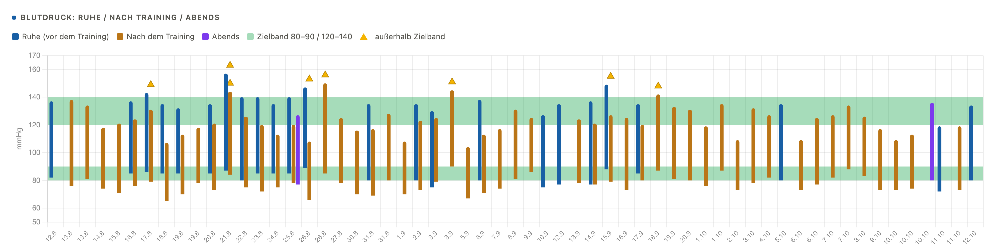
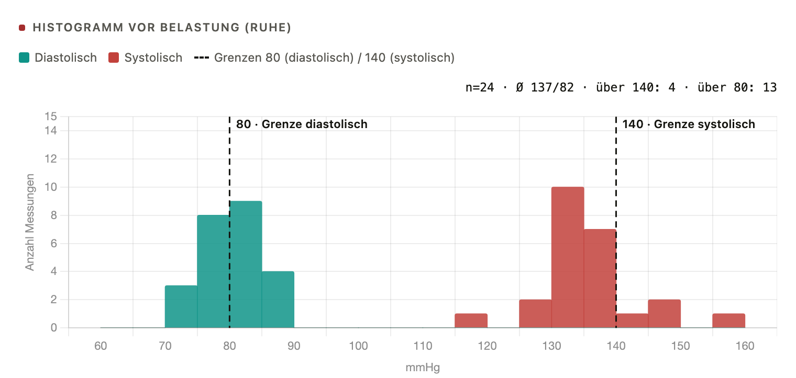
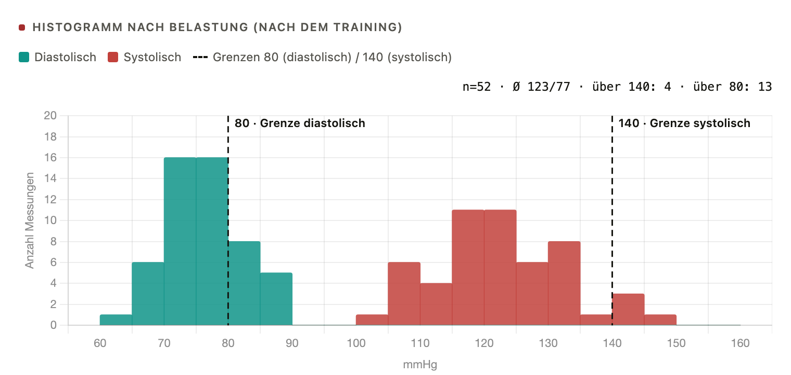

Zeitraum 12.8–12.10.2026 (letzte zwei Monate), 59 Einträge. Werte als SYS/DIA/PULS, Nr = Einheit (– = Ruhetag). **Fett** = über dem Zielband (über 140 bzw. 90).

Mittelwerte: Ruhe 137/82/72 (n=24), nach Training 123/77/87 (n=52), abends 132/78/73 (n=2).

| Datum | Nr | Ruhe | nach Training | Abend |
|:--|:--|:--|:--|:--|
| 12.8 | – | 137/82/70 (16:42) |  |  |
| 13.8 | 84 |  | 138/76/90 |  |
| 13.8 | 85 |  | 134/81/92 |  |
| 14.8 | 86 |  | 118/74/91 |  |
| 15.8 | 87 |  | 121/71/86 |  |
| 16.8 | 88 | 137/85/73 | 124/76/89 |  |
| 17.8 | 89 | **143**/86/71 (12:46) | 131/79/90 |  |
| 18.8 | 90 | 135/85/70 | 107/65/87 |  |
| 19.8 | 91 | 132/85/78 | 113/70/87 |  |
| 19.8 | 92 |  | 118/78/97 |  |
| 20.8 | 93 | 135/85/71 | 121/73/87 |  |
| 21.8 | 94 | **157**/87/80 | **144**/84/84 |  |
| 22.8 | 95 | 140/80/73 | 126/75/87 |  |
| 23.8 | 96 | 140/85/70 | 120/72/89 |  |
| 24.8 | 97 | 135/85/67 | 113/75/83 |  |
| 25.8 | 98 | 140/85/68 | 120/78/80 | 127/77/76 |
| 26.8 | 99 | **147**/89/80 (11:36) | 108/66/82 |  |
| 26.8 | 100 |  | **150**/85/85 |  |
| 27.8 | 101 |  | 125/78/87 |  |
| 30.8 | 102 |  | 116/70/87 |  |
| 31.8 | 103 | 135/80/70 | 117/69/94 |  |
| 31.8 | 104 |  | 128/80/94 |  |
| 1.9 | 105 |  | 108/70/84 |  |
| 2.9 | 106 | 135/80/77 | 123/73/84 |  |
| 3.9 | 107 | 130/75/67 | 125/79/87 |  |
| 3.9 | 108 |  | **145**/90/81 |  |

| Datum | Nr | Ruhe | nach Training | Abend |
|:--|:--|:--|:--|:--|
| 5.9 | 109 |  | 104/67/93 |  |
| 6.9 | 110 | 138/80/67 | 113/71/88 |  |
| 7.9 | 111 |  | 117/74/82 |  |
| 8.9 | 112 |  | 131/81/81 |  |
| 9.9 | 113 |  | 125/86/74 |  |
| 10.9 | – | 127/75/71 |  |  |
| 12.9 | – | 135/77/68 |  |  |
| 13.9 | 114 |  | 124/78/93 |  |
| 14.9 | 115 | 137/77/78 | 121/77/86 |  |
| 15.9 | 116 | **149**/88/72 (05:11) | 127/79/89 |  |
| 16.9 | 117 |  | 125/73/94 |  |
| 17.9 | 118 | 135/85/69 | 120/80/92 |  |
| 18.9 | 119 |  | **142**/87/90 |  |
| 19.9 | 120 |  | 133/81/92 |  |
| 20.9 | 121 |  | 131/80/97 |  |
| 1.10 | 122 |  | 119/76/97 |  |
| 1.10 | 123 |  | 135/87/85 |  |
| 2.10 | 124 |  | 109/73/93 |  |
| 3.10 | 125 |  | 132/78/90 |  |
| 4.10 | 126 |  | 127/82/77 |  |
| 5.10 | – | 135/80/69 |  |  |
| 6.10 | 127 |  | 109/73/94 |  |
| 6.10 | 128 |  | 125/77/80 |  |
| 7.10 | 129 |  | 127/82/90 |  |
| 7.10 | 130 |  | 134/88/80 |  |
| 8.10 | 132 |  | 126/83/87 |  |
| 9.10 | 134 |  | 117/73/80 |  |
| 10.10 | 136 |  | 109/73/87 |  |
| 10.10 | 137 |  | 113/74/73 |  |
| 10.10 | – |  |  | 136/80/70 (23:12) |
| 11.10 | – | 119/72/73 (08:54) |  |  |
| 11.10 | 138 |  | 119/73/77 |  |
| 12.10 | – | 134/80/81 (09:49) |  |  |

\onecolumn

{width=100%}

{width=49%} {width=49%}
